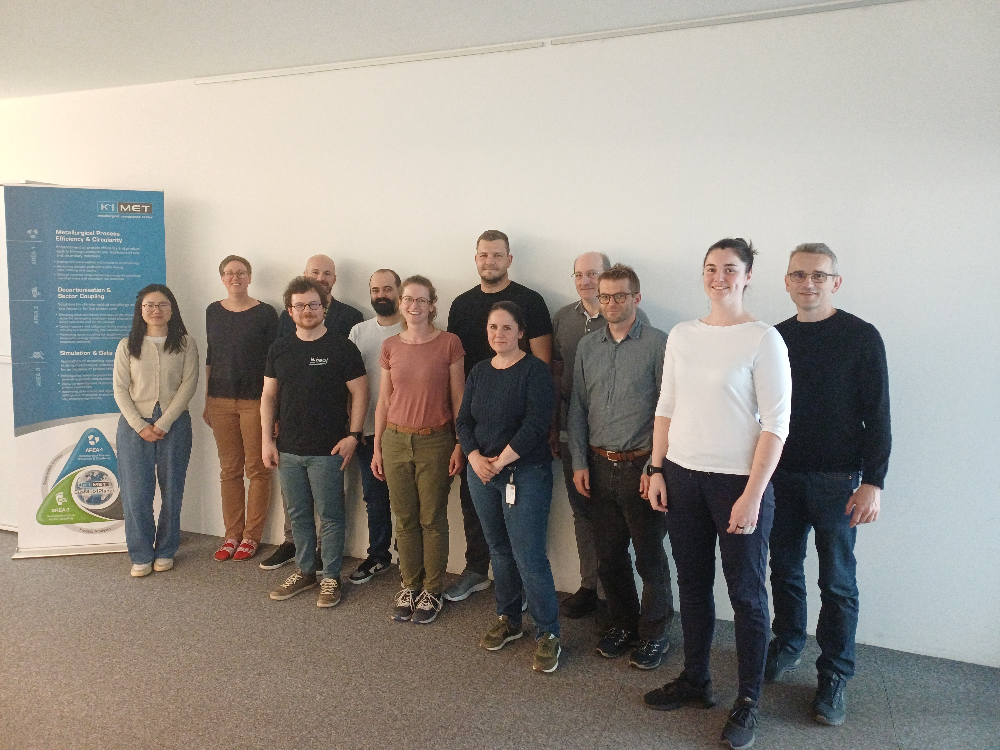

Das kooperative Forschungs- und Entwicklungsprojekt **HARMONY** ist gestartet. Gemeinsam entwickeln K1-MET, die FH OÖ und voestalpine hybride Prozessmodelle für die Stahlproduktion. Zum Auftakt kam das Konsortium zusammen, um die gemeinsame Arbeit auf den Weg zu bringen.

<!--more-->

**HARMONY** steht für *Hybrid AI and Rule-based Modelling for Optimized Operations in Next-Generation Steel Industry*. Im Mittelpunkt steht der Vakuumrezirkulationsprozess (RH), der bei der Herstellung hochwertiger Stähle eine wichtige Rolle spielt. Ziel des Projekts ist es, diesen komplexen metallurgischen Prozess besser zu verstehen und eine Grundlage für seine ressourceneffiziente Optimierung zu schaffen.

### Neue Sensorik, Prozesswissen und hybride KI

Die Forschungsarbeit verbindet mehrere Ansätze: Neue und weiterentwickelte Sensorsysteme sollen zusätzliche Einblicke in den RH-Prozess ermöglichen. Die gewonnenen Messdaten werden aufbereitet und mit metallurgischem Fachwissen sowie physikalischen Modellen zusammengeführt. Darauf aufbauend entwickelt das Team Methoden der wissensgeleiteten symbolischen Regression, die Daten und Domänenwissen in einem hybriden Lernverfahren verbinden.

So sollen Prozessmodelle entstehen, die **interpretierbar, robust und echtzeitfähig** sind. Ihre Leistungsfähigkeit und industrielle Anwendbarkeit werden in Fallstudien und gezielten Anlagenversuchen untersucht.

### Gemeinsam von der Messung zum Modell

Das Projekt vereint die komplementären Kompetenzen aller drei Partner: K1-MET übernimmt die Konsortialleitung und bringt metallurgisches Wissen, Simulation sowie die Aufbereitung und Analyse von Prozessdaten ein. Die FH OÖ entwickelt neue Methoden der hybriden Modellierung. voestalpine trägt mit Sensorik, Anlagendaten und betrieblichem Prozesswissen bei und unterstützt die Erprobung unter industriellen Bedingungen.

HARMONY wird im Rahmen des FFG-Programms **AI Ökosysteme 2025: AI for Tech & AI for Green** gefördert. Weitere Informationen zum Forschungsvorhaben finden Sie in unseren [Projektinformationen]({{ '/#info' | relative_url }}).

**Projektpartner:**
- K1-MET GmbH
- FH OÖ Forschungs & Entwicklungs GmbH
- voestalpine Stahl GmbH

 

   
