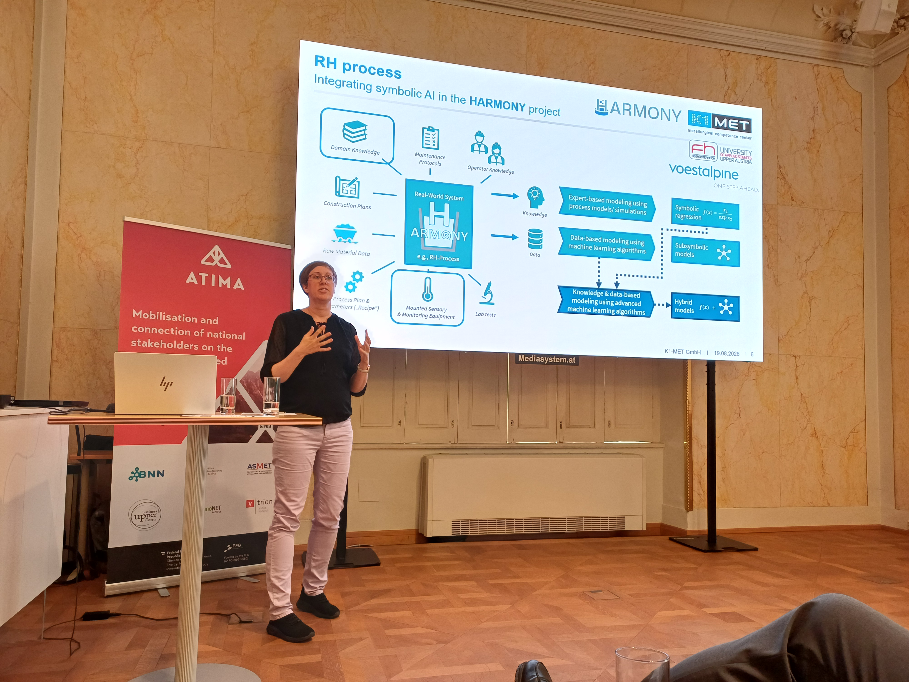

K1-MET nahm vom 18. bis 19. August 2026 am ASMET-Werkstoffworkshop 2026 teil, dessen Schwerpunkt auf dem Thema „KI in der Werkstoffentwicklung und -produktion“ lag.

<!--more-->

Ziel war es, gemeinsam neue Forschungs- und Entwicklungsschwerpunkte zu identifizieren und Impulse für die nächste Generation datengesteuerter Werkstoffe und Produktionstechnologien zu geben. Der Workshop fand bei der Joanneum Research Forschungsgesellschaft mbH in Graz statt und bot eine hervorragende Gelegenheit, Erfahrungen auszutauschen und den Forschungsbedarf sowie zukünftige Entwicklungen im Bereich der Werkstoffe unter Einbeziehung von KI zu diskutieren!

Christine Gruber hielt einen Vortrag zum Thema „Hybride KI und regelbasierte Modellierung: Interpretierbare, robuste und in Echtzeit einsetzbare hybride Prozessmodelle für die Stahlproduktion“.

 

