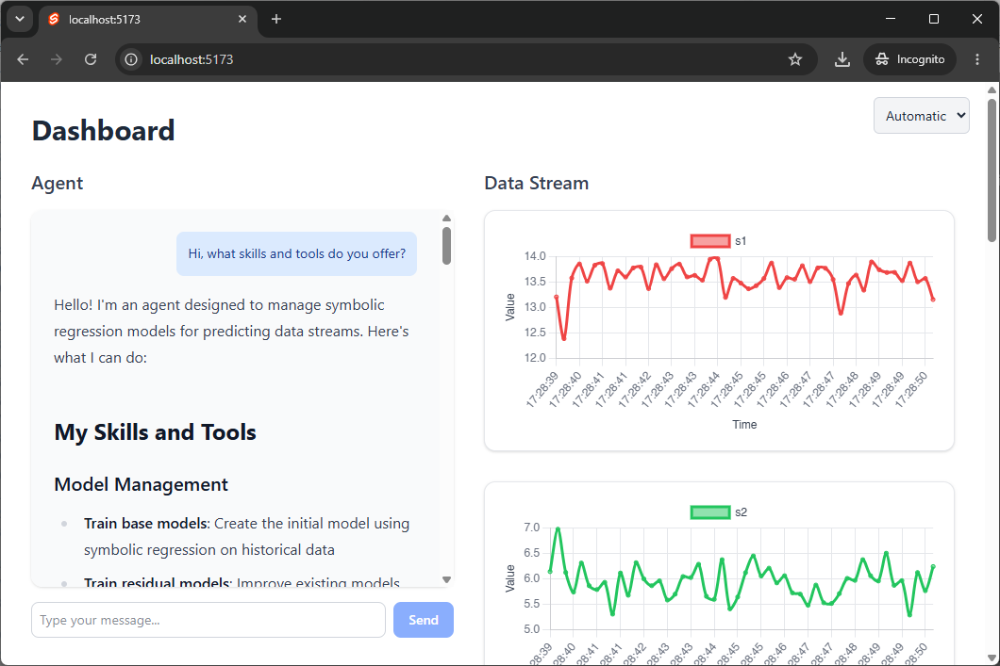
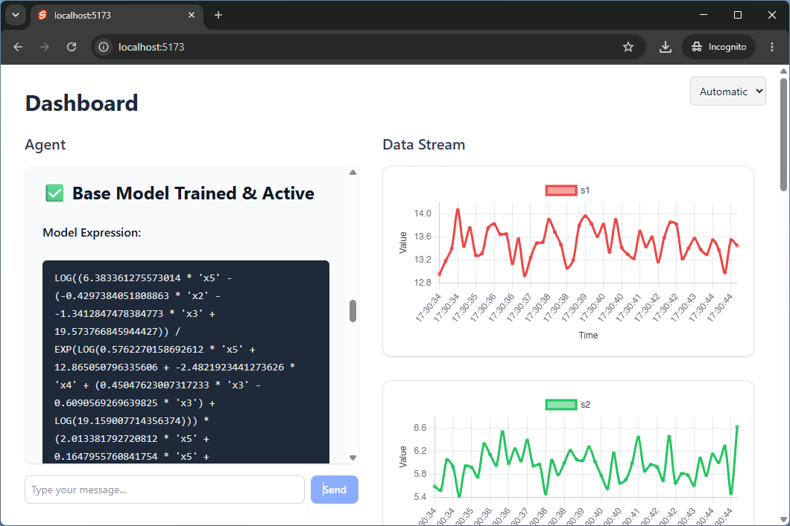
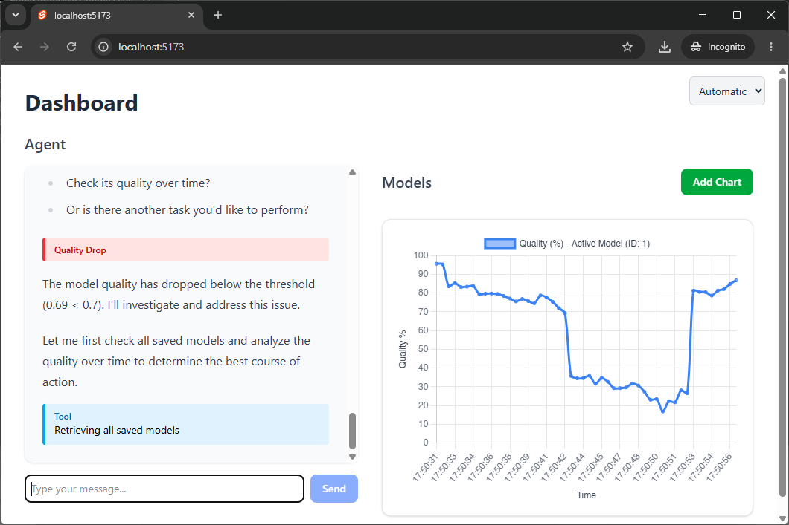
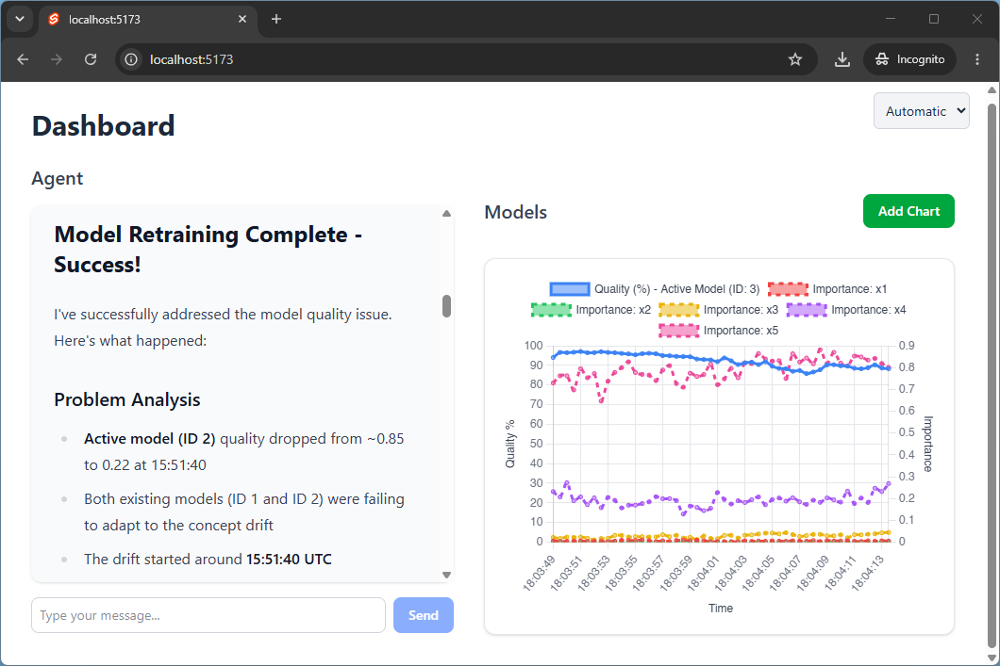

Vom 10. bis 14. November 2026 findet die wissenschaftliche Konferenz ISM 2026 in Padua (Italien) statt. Das HARMONY-Team ist mit einem wissenschaftlichen Beitrag und einem eigenen Conference-Track vertreten.

<!--more-->

Die **International Conference on Industry of the Future and Smart Manufacturing (ISM)** bietet jährlich ein Forum für den Austausch über digitale Technologien und ihre Rolle in der Industrie der Zukunft.

Das Team von **HARMONY** bringt sich mit zwei Beiträgen in das Konferenzprogramm ein:

- **Full Paper:** Zenisek et al. (2026). *Design of a symbolic regression modeling and interpretation agent for industrial data stream analysis.* Procedia Computer Science.
- **Conference-Track:** *Software Design Aspects for Industrial Machine Learning*

Im angenommenen Full Paper stellt das Team einen KI-Agenten vor, der symbolische Regression zur Analyse industrieller Sensordatenströme einsetzt. Eine LLM-basierte Prompting-Schnittstelle ermöglicht die Interaktion mit dem Agenten. Die folgenden Screenshots geben einen ersten Einblick in die entwickelte Anwendung.

Weitere Informationen zur Veranstaltung finden Sie auf der [Website der ISM 2026](https://www.msc-les.org/ism2026/){:target="_blank"}.

 

    
    
    
   
